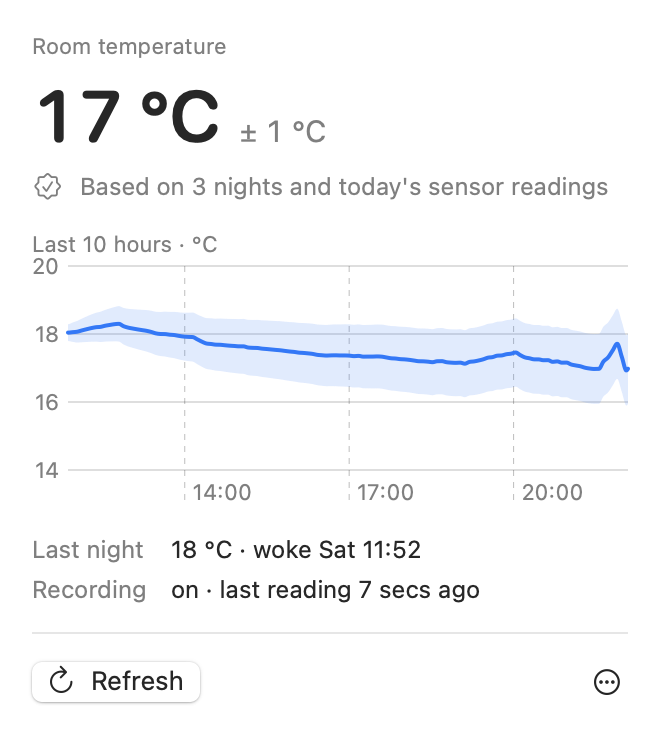

<p align="center">
  
</p>

<h1 align="center">thermac</h1>

<p align="center">
  <b>Your Mac is already a thermometer.</b><br>
  thermac estimates the temperature of the room you're in using only your Mac's own sensors:<br>
  no extra hardware, no root, no network.
</p>

<p align="center">
  
  
  
  
</p>

<p align="center">
  
  &nbsp;&nbsp;
  
</p>

---

> [!WARNING]
> **Experimental.** Expect about **± 1 °C**. It improves over the first few nights as thermac
> learns how your Mac heats up. It is not a calibrated instrument; don't use it for anything
> safety-related.

## How it works

A Mac has dozens of temperature sensors: battery, SSD, palm rest, display, chip. When it's
idle they settle *above* the room temperature by an amount that depends on how much power
the Mac uses. thermac records those sensors and the power rails in the background, and then
estimates the room temperature in three ways:

1. **Overnight cooling.** While the Mac sleeps it uses almost no power, so every sensor
   cools straight toward the room temperature. macOS wakes the Mac every ~15 minutes for
   maintenance, and the readings taken then trace the cooling curve. Its end point is
   the room temperature. This is the most reliable estimate (sensors typically agree
   within ~0.2 °C).
2. **A model of your Mac.** Each night tells thermac what the room was at both ends of the
   day. From that it learns how each sensor responds to power use, including heat from
   charging, and works backwards from the live readings to the room temperature.
3. **A Kalman filter** combines the two. It trusts the overnight value most, trusts the
   model less while charging or just after waking, and always reports a ± uncertainty.

Plain cool-down fitting on an awake Mac does not work: it ends up 8–10 °C too warm,
because the idle Mac keeps heating itself.

## Requirements

- A Mac with **Apple Silicon** (M1 or later). Intel Macs are not supported.
- **macOS 14 Sonoma** or later.
- To build from source: the **Xcode Command Line Tools** with Swift 6
  (`xcode-select --install`). The full Xcode app is not needed.

Developed and tested on a MacBook Pro with M4 Pro (Mac16,8). Other Apple Silicon Macs should
work. Run `thermac doctor` to check yours, and please [report the result](#contributing).
Desktop Macs (mini, Studio, iMac) have no battery sensors, so expect lower accuracy.

## Installation

There are no pre-built downloads yet; build it from source. It takes about a minute.

### 1. Get the code

```sh
git clone https://github.com/umairleo1/thermac.git
cd thermac
```

### 2. Build and install the menu bar app

```sh
scripts/bundle-app.sh --install
open ~/Applications/ThermacBar.app
```

This builds the app and moves it to `~/Applications`. It appears in the menu bar as a
thermometer.

### 3. Start recording

Click the thermometer in the menu bar, then **Start Recording**. If macOS asks, allow
thermac in **System Settings → General → Login Items**.

The recorder runs in the background at login. It reads the sensors every 5 seconds, uses
about 0.03 % CPU, and stores about 10 MB a day (older data is thinned automatically).

### 4. Let it sleep

Close the lid overnight, or let the Mac sleep for **2 hours or more**. The first estimate
appears after the first night, and the live estimate after the second night with a day of
use in between.

> [!TIP]
> To open thermac automatically at login, turn on **Settings → Open thermac at login**
> (click the thermometer, then **⋯ → Settings…**).

### Command line only (optional)

If you prefer no menu bar app:

```sh
swift build -c release
.build/release/thermac doctor           # check this Mac (GO / NO-GO)
.build/release/thermac agent install    # start the background recorder
.build/release/thermac now              # current estimate
```

The menu bar app detects a recorder installed this way and uses it instead of starting a
second one. You can switch it over in **Settings → Background recording**.

## Using thermac

**Menu bar:** the current room temperature, e.g. `🌡 18°`. A `?` means the recorder has
stopped.

**Panel:** the estimate with its uncertainty, what it's based on, a chart of the last 24
hours (hover to read values), last night's value, and recording status.

**Settings:** units (°C, °F, or your system setting), whole degrees or one decimal, refresh
rate, open at login, and background recording.

<p align="center">
  
</p>

### Command-line tool

| Command | What it does |
|---|---|
| `thermac doctor` | Checks which sensors and power readings work on this Mac |
| `thermac sensors [--all]` | Lists the channels thermac records, by category |
| `thermac now` | Live room estimate (same as the menu bar) |
| `thermac status` | Database summary: samples, gaps, sleep/wake, cold-start anchors |
| `thermac events --since 24h` | Sleep, wake and cold-start events |
| `thermac export --since 7d -o data.csv` | Exports recorded data as CSV |
| `thermac agent install` / `uninstall` / `status` | Background recorder from the command line |
| `thermac validate` | Compares all estimators at every overnight anchor |
| `thermac calibrate` | Leave-one-day-out test of the learned model |
| `thermac replay` | Replays the log through the filter; predicts each next night |
| `thermac simulate --seed 2` | Reference simulation against a known room temperature |

Run `thermac help` for all options.

## Uninstalling

1. Click the thermometer, then **⋯ → Settings… → Stop Recording**, then **⋯ → Quit thermac**.
2. Delete `~/Applications/ThermacBar.app`.
3. Optionally delete the recorded data:
   ```sh
   rm -rf ~/Library/Application\ Support/thermac
   ```

If you installed the recorder from the command line, also run
`.build/release/thermac agent uninstall`.

## Privacy

thermac makes **no network connections**. Everything it records, which is sensor
temperatures, power readings, and sleep/wake times, stays in
`~/Library/Application Support/thermac/` on your Mac.

## Limitations

- **Accuracy is about ± 1 °C**, and lower in the first days. Moving the Mac (desk ↔ lap ↔
  bed), heavy charging, and sudden load changes cause temporary errors; the ± shown in the
  app reflects this.
- **It needs sleep.** Overnight sleep is what keeps the estimate anchored. A Mac that never
  sleeps gets only the model estimate, with a growing ±.
- **Private interfaces.** thermac reads sensors through undocumented macOS interfaces (SMC
  and IOHID), as other system monitors do. A macOS update could break them. It can't be
  distributed through the Mac App Store.
- **Unsigned builds.** Apps you build yourself run normally. Pre-built downloads will need
  Developer ID signing and notarization, which is planned.

## Development

```sh
swift build                     # debug build
scripts/test.sh                 # unit tests (wraps `swift test`; see below)
scripts/bundle-app.sh           # build dist/ThermacBar.app
swift scripts/make-icon.swift   # regenerate Resources/AppIcon.icns
```

`scripts/test.sh` exists because with the Command Line Tools alone, `swift test` can't always
find the Swift Testing macro plugin; the script passes it explicitly. In the same way, the
app uses `ObservableObject` instead of `@Observable`/`@State`, whose macro plugins don't ship
with the Command Line Tools.

**Layout**

```
Sources/
  CThermacPrivate/   C shims: IOHID sensor services, AppleSMC client, IOReport
  ThermacCore/       sensors, catalog, SQLite store, recorder, estimators, filter
  thermac/           command-line tool
  ThermacBar/        SwiftUI menu bar app
Tests/ThermacCoreTests/   unit and simulation tests
scripts/             test runner, app bundler, icon generator
Resources/           app icon
assets/              README images
```

## Contributing

The most useful contribution right now is **data from other Macs**:

1. Run `thermac doctor` and `thermac sensors`, and open an issue with the output and your
   Mac model.
2. If you have a thermometer, compare it with `thermac now` and report both, with the
   time and conditions (heating, window, where the Mac was).

Bug reports and pull requests are welcome. Please run `scripts/test.sh` before opening a PR.

## Acknowledgements

Sensor access builds on public reverse-engineering work: [iSMC](https://github.com/dkorunic/iSMC),
the [Asahi Linux](https://asahilinux.org) SMC documentation, and
[macmon](https://github.com/vladkens/macmon). The modelling draws on grey-box thermal
identification literature and on published patents on device-based ambient temperature
estimation.

## License

MIT. See [LICENSE](LICENSE).
