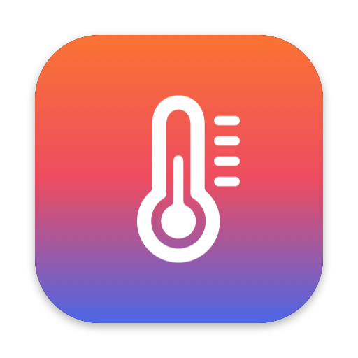
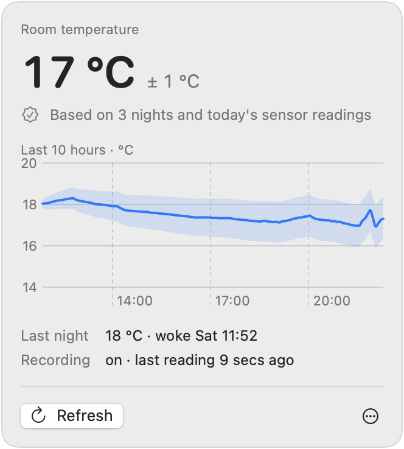
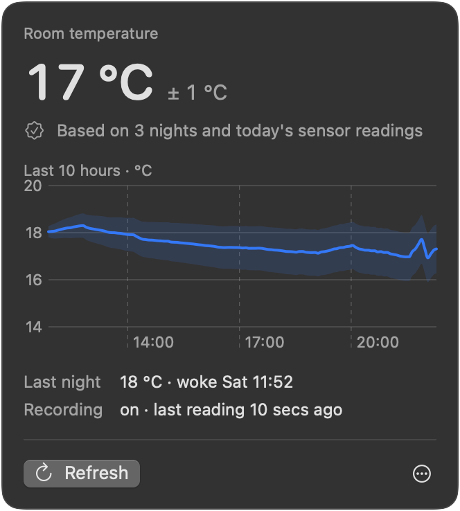
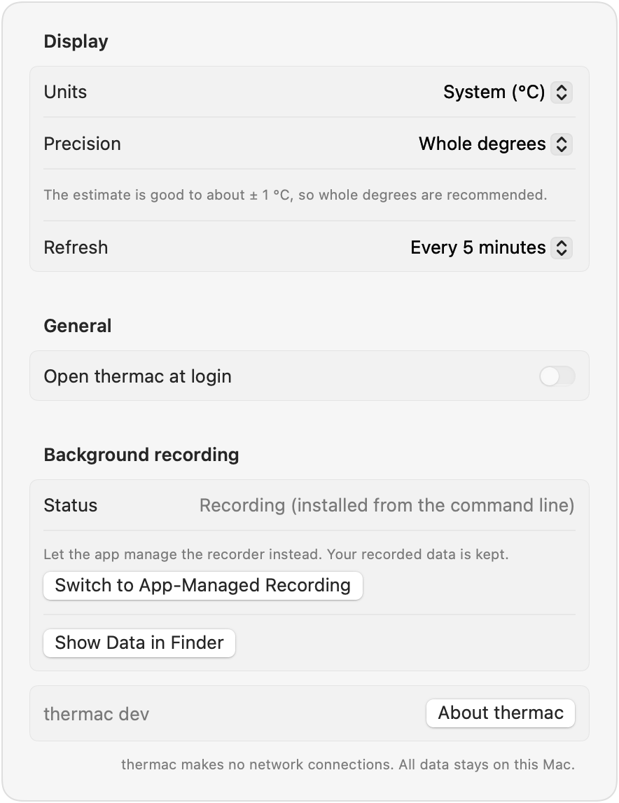

<p align="center">
  
</p>

<h1 align="center">thermac</h1>

<p align="center">
  <b>Your Mac is already a thermometer.</b><br>
  thermac estimates the temperature of the room you're in using only your Mac's own sensors:<br>
  no extra hardware, no root, no network.
</p>

<p align="center">
  <a href="https://github.com/umairleo1/thermac/actions/workflows/ci.yml"></a>
  <a href="https://github.com/umairleo1/thermac/releases"></a>
  
  
  
  <a href="LICENSE"></a>
</p>

<p align="center">
  
  &nbsp;&nbsp;
  
</p>

<p align="center">
  <a href="#installation">Install</a> ·
  <a href="#how-it-works">How it works</a> ·
  <a href="#accuracy">Accuracy</a> ·
  <a href="#troubleshooting--faq">FAQ</a> ·
  <a href="#contributing">Contribute</a>
</p>

---

> [!WARNING]
> **Experimental.** Expect about **± 1 °C**, and less precision in the first days. thermac is
> not a calibrated instrument; don't use it for anything safety-related.

## Installation

Paste this in Terminal:

```sh
curl -fsSL https://raw.githubusercontent.com/umairleo1/thermac/main/install.sh | sh
```

The installer checks your Mac, downloads the source, builds it (about a minute), installs
the app as `~/Applications/ThermacBar.app`, links the `thermac` command to
`~/.local/bin`, and opens the app. It needs no `sudo` and installs nothing outside your home
folder. You can [read the script](install.sh) before running it, which is good practice
with any `curl | sh`.

**Requirements:** a Mac with Apple Silicon (M1 or later), macOS 14 Sonoma or later, and the
Xcode Command Line Tools (`xcode-select --install`; the full Xcode app isn't needed). The
installer checks all three and tells you what's missing.

<details>
<summary>Install manually instead</summary>

```sh
git clone https://github.com/umairleo1/thermac.git
cd thermac
scripts/bundle-app.sh --install
open ~/Applications/ThermacBar.app
```

</details>

### Getting started

1. **Start recording.** Click the thermometer in the menu bar, then **Start Recording**. If
   macOS asks, allow thermac in **System Settings → General → Login Items**. The recorder
   reads the sensors every 5 seconds in the background, uses about 0.03 % CPU, and stores
   about 10 MB a day (older data is thinned automatically).
2. **Let it sleep.** Close the lid overnight, or let the Mac sleep for 2 hours or more.
   The first reading appears after the first night; the live estimate starts after the
   second night with a day of use in between.
3. **Optional:** turn on **Settings → Open thermac at login** (click the thermometer, then
   **⋯ → Settings…**).

### Updating and uninstalling

Run the install command again to update; your recorded data is kept. To uninstall:

```sh
curl -fsSL https://raw.githubusercontent.com/umairleo1/thermac/main/install.sh | sh -s -- --uninstall
```

This removes the app, the background recorder and the `thermac` command, and keeps your
recorded data. Add `--purge` to delete the data too.

## How it works

A Mac has dozens of temperature sensors: battery, SSD, palm rest, display, chip. When it's
idle they settle *above* the room temperature by an amount that depends on how much power
the Mac uses. thermac records those sensors and the power rails, and estimates the room
temperature in three ways:

1. **Overnight cooling.** While the Mac sleeps it uses almost no power, so every sensor
   cools straight toward the room temperature. macOS wakes the Mac every ~15 minutes for
   maintenance, and the readings taken then trace the cooling curve. Its end point is
   the room temperature. This is the most reliable estimate.
2. **A model of your Mac.** Each night tells thermac what the room was at both ends of the
   day. From that it learns how each sensor responds to power use, including heat from
   charging, and works backwards from the live readings to the room temperature.
3. **A Kalman filter** combines the two. It trusts the overnight value most, trusts the
   model less while charging or just after waking, follows large sudden changes (the Mac
   carried to a colder room), and always reports a ± uncertainty.

Why not simply watch the Mac cool down while it's awake? Because an idle Mac keeps heating
itself: a plain cool-down fit ends up 8–10 °C too warm.

## Accuracy

Honest numbers, measured so far on **one Mac** (MacBook Pro, M4 Pro) over **three nights**,
without a reference thermometer:

| Check | Result |
|---|---|
| Overnight estimate: agreement between ~27 independent sensors | ± 0.14–0.23 °C |
| Overnight estimate vs. sensor readings at wake-up after long sleeps | within 0.1 °C |
| Live estimate: predicting the next night's value at the end of a day spent in one place | −0.18 °C (1 day so far) |
| Live estimate through the day vs. the overnight reference (at home) | 0.53 °C RMS, 0.1 °C jitter per 5 min |
| Simulation with a known room temperature (realistic noise, 12 random scenarios) | within 0.2 °C |

**Known error sources:** heavy charging and the first hour after waking cause temporary
errors of 1–3 °C. When you carry the Mac somewhere else with the lid closed (e.g. to work),
thermac treats the room as unknown again and re-converges over the next hour or two. The ± shown in the app accounts for
this. Results from other Macs, and comparisons with real thermometers, are very welcome;
see [Contributing](#contributing).

## Using thermac

**Menu bar:** the current room temperature, e.g. `🌡 17.6°`. A `?` means the recorder has
stopped.

**Panel:** the estimate with its uncertainty, the trend over the last hour, what it's based
on, a chart of the last 24 hours (hover to read values), last night's value, and the
recording status.

**Settings:** units (°C, °F, or your system setting), menu bar precision, refresh rate,
response (*Steady*, the default and most accurate, or *Responsive*, which reacts within
about an hour but jitters more), open at login, and background recording.

<p align="center">
  
</p>

### Command-line tool

The installer links `thermac` to `~/.local/bin` (add that folder to your `PATH` if needed).

| Command | What it does |
|---|---|
| `thermac doctor` | Checks which sensors and power readings work on this Mac |
| `thermac now` | Current room estimate (same as the menu bar) |
| `thermac sensors [--all]` | Lists the channels thermac records, by category |
| `thermac status` | Recording summary: samples, gaps, sleep/wake, overnight readings |
| `thermac events --since 24h` | Sleep, wake and overnight-reading events |
| `thermac export --since 7d -o data.csv` | Exports recorded data as CSV |
| `thermac validate` | Compares all estimators at every overnight reading |
| `thermac replay` | Replays the recorded log through the filter and scores it |
| `thermac agent install` / `uninstall` | Runs the recorder without the menu bar app |

Run `thermac help` for all commands and options.

## Troubleshooting & FAQ

<details>
<summary><b>The menu bar shows "—"</b></summary>

thermac needs one night (or any sleep of 2 hours or more) before it can show a reading.
Check that recording is on: click the thermometer; the panel says "Recording: on".
</details>

<details>
<summary><b>The number barely changes</b></summary>

That's expected. A Mac takes hours to warm up or cool down, so real room changes appear
over the next hour or two. The trend line ("Up 0.2 °C in the last hour") shows the movement.
For faster (but noisier) tracking, choose **Settings → Response → Responsive**.
</details>

<details>
<summary><b>"Start Recording" asks for approval, or nothing happens</b></summary>

Open **System Settings → General → Login Items** and turn on thermac under *Allow in the
Background*. The app must run from `~/Applications` (where the installer puts it).
</details>

<details>
<summary><b>The installer says the Command Line Tools are missing</b></summary>

Run `xcode-select --install`, wait for it to finish, and run the installer again.
</details>

<details>
<summary><b>Does it work on a Mac mini, Mac Studio or iMac?</b></summary>

Probably, but with lower accuracy: desktop Macs have no battery sensors, which are among the
most useful slow sensors. Run `thermac doctor` and please
[share the result](https://github.com/umairleo1/thermac/issues/new?template=mac-report.yml).
</details>

<details>
<summary><b>Intel Macs?</b></summary>

Not supported. thermac relies on the sensor and power interfaces of Apple Silicon.
</details>

<details>
<summary><b>Will a macOS update break it?</b></summary>

It could. thermac reads sensors through undocumented macOS interfaces (SMC and IOHID), as
other system monitors do. If an update breaks it, please open an issue.
</details>

## Privacy

thermac makes **no network connections**. Everything it records (sensor temperatures, power
readings, sleep and wake times) stays in `~/Library/Application Support/thermac/` on your
Mac.

## Limitations

- **Accuracy is about ± 1 °C**, and lower in the first days. See [Accuracy](#accuracy).
- **It needs sleep.** Overnight sleep keeps the estimate anchored; a Mac that never sleeps
  gets only the model estimate, with a growing ±.
- **Private interfaces.** Undocumented macOS interfaces may change, and the app can't be
  distributed through the Mac App Store.
- **No pre-built downloads yet.** The installer builds from source. Signed, notarized
  downloads are planned.

## Development

```sh
swift build                     # debug build
scripts/test.sh                 # tests with the Command Line Tools (or `swift test` with Xcode)
scripts/bundle-app.sh           # build dist/ThermacBar.app
swift scripts/make-icon.swift   # regenerate Resources/AppIcon.icns
```

With only the Command Line Tools, `swift test` can't always find the Swift Testing macro
plugin, so `scripts/test.sh` passes it explicitly. For the same reason, the app uses
`ObservableObject` rather than `@Observable` or `@State`.

```
Sources/
  CThermacPrivate/   C shims: IOHID sensor services, AppleSMC client, IOReport
  ThermacCore/       sensors, catalog, SQLite store, recorder, estimators, filter
  thermac/           command-line tool
  ThermacBar/        SwiftUI menu bar app
Tests/ThermacCoreTests/   unit and simulation tests
scripts/             test runner, app bundler, icon generator
```

## Contributing

The most useful contribution right now is **data from other Macs**: run `thermac doctor`
and open a [Mac report](https://github.com/umairleo1/thermac/issues/new?template=mac-report.yml).
Comparisons with a real thermometer are even better.

Bug reports and pull requests are welcome; see [CONTRIBUTING.md](CONTRIBUTING.md). For
security issues, see [SECURITY.md](SECURITY.md). Changes are listed in the
[CHANGELOG](CHANGELOG.md).

## Acknowledgements

Sensor access builds on public reverse-engineering work: [iSMC](https://github.com/dkorunic/iSMC),
the [Asahi Linux](https://asahilinux.org) SMC documentation, and
[macmon](https://github.com/vladkens/macmon). The modelling draws on grey-box thermal
identification literature and on published patents on device-based ambient temperature
estimation.

## License

[MIT](LICENSE) © umairleo1
